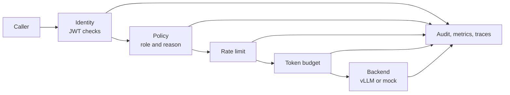

# Secure GPU Inference Gateway

A Python service that sits in front of an LLM server and decides who can call which
model, enforces rate and token limits, and records every decision. It proxies
streaming traffic to vLLM, or to a mock backend when no GPU is available.

## Result

Against a backend that does no work, the full control path adds **4.7 ms at p50**.

| Limiter | Added p50 | Added p95 | Added p99 | Requests/s |
|---|---:|---:|---:|---:|
| [In-memory](bench/results/20261031T025753Z-null-backend-ryzen9800x3d-memory/report.md) | 4.7 ms | 5.3 ms | 5.5 ms | 205 |
| [Redis](bench/results/20261031T030824Z-null-backend-ryzen9800x3d-redis/report.md) | 5.5 ms | 6.3 ms | 6.6 ms | 173 |

One connection, one uvicorn worker, loopback, Ryzen 7 9800X3D under WSL, five paired
repetitions of 5,000 requests. The run fails unless every gateway request leaves an
audit event and a trace span. Requests per second is this single worker's ceiling,
not a capacity figure.

Against real vLLM on an RTX 5070 Ti, throughput tracked direct within run-to-run
variance across 3,000 requests with no failures, so no overhead or speedup is claimed
for that path. See the
[report](bench/results/20260803T212059Z-rtx5070ti-qwen25-3b-vllm026/report.md).

## How it works



A denial at any step stops the request and is still recorded.

## Run it

```bash
pip install -r requirements.txt
ALLOW_DEMO_PRINCIPALS=true uvicorn gateway.app:app --reload
curl -X POST http://localhost:8000/v1/infer/mission-summarizer -H "Content-Type: application/json" -H "X-Principal-Id: analyst-1" -d "{\"input\":\"Summarize synthetic maintenance delays\", \"reason\":\"readiness review\"}"
```

The demo header is off unless you opt in, as above. Everything else, including JWT
setup, Redis mode, the vLLM path, Grafana and Kubernetes, is in the
[reference](docs/REFERENCE.md).

## Design decisions

1. **Fail closed.** Demo identities are off by default, an unknown caller is denied,
   and a gateway configured for Redis refuses to start if Redis is unreachable. A
   Kubernetes smoke test in CI confirms that a demo request is denied in the deployed
   manifest.
2. **Check, then count, atomically.** The Redis limiter is one Lua script, so replicas
   cannot race between reading and incrementing. A denied request spends nothing, so
   it cannot block later requests that fit. CI runs this on real Redis.
3. **Record decisions, not content.** Audit events and traces hold who, which model and
   why, never the prompt, output or access reason. Principal IDs are hashed in Redis keys.

## Limitations

- HS256 JWTs are for local testing. Production OIDC needs JWKS-backed signing and key
  rotation.
- Token budgets use estimated input tokens, and do not count output.
- One Python worker tops out near 200 requests per second, and I have not yet profiled
  where the 4.7 ms goes.
- Measured on one workstation. Capacity, workload and resilience artifacts are
  synthetic. They exercise the planning logic, not a real fleet.

## More

- [Reference: setup, modes and evidence](docs/REFERENCE.md)
- [Architecture](ARCHITECTURE.md)
- [Threat model](THREAT_MODEL.md)
- [Operations](docs/OPERATIONS.md)
- [Benchmark method](bench/README.md)
